<div align="center">


# ⚓｜NeoNote - FileEditor

**説明：** あらゆるデータを自在に編集するための超汎用ファイルエディタ。艦長が利便性を追求した超汎用ファイルエディタ。

*~Note of Creation~*


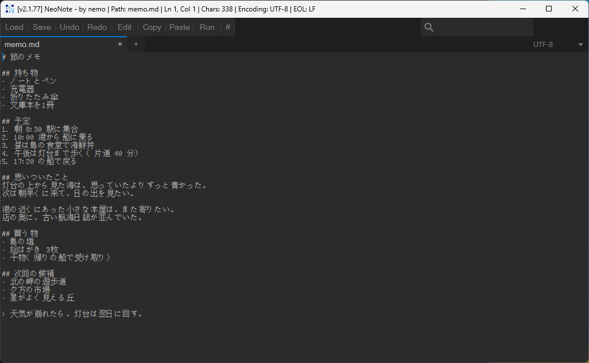

</div>

---

## ❱ 情報【Information】

設計理念は「**とにかく軽く、早く、省クリック数で動作する**」こと。<br>
メモからコーディングなど。手軽な作業にVSCode や Eclipse のような鈍間な重機を持ち出すのはナンセンスだぜ？<br>
特にマイクラ民向け（JSON の整形、`level.dat`・`.mca` の編集）。

```text
App      : NeoNote
Version  : 2.1.77
Language : Rust (fltk-rs)
Tested   : Windows 11（Linux・macOS）
Author   : argonaute_nemo
```

---

## ❱ 特徴【Highlights】

- ⚡ **単一の実行ファイル**：インストール不要。ダウンロードしてすぐ使える
- 🧹 **もっとシンプルに！**：行番号と右パネルは、マウスを画面の端へ寄せた時か `Alt` を押した時だけ表示
- 🖱️ **省クリック！**：ツールバーのボタンは押せば主な操作、マウスを乗せると関連する操作の一覧
- 🔁 **続きから**：前回のタブと未保存の変更を、次の起動でそのまま戻す（設定で切れる）
- 🎨 **千変万化のカラーテーマ**：UIの構成配色を全て自由に変更可能。10のカラーテーマと無限の自由配色。月のボタンで明暗を切り替え
- 🌐 **日本語と英語**：旗のボタンで、メニューや説明の言葉を切り替えられる
- 🔤 **幅広い対応性**：あらゆる文字コード、フォーマットファイル形式など自動で読み込みプレビューできます。UTF-8・Shift_JIS・EUC-JP・UTF-16 + 改行コード（CRLF / LF）など。
- 👀 **プレビュー**：Markdown・HTML・CSV・Excel・Word・zip などをその場で表示。拡張子が txt でも形式を選んでプレビューできる
- 🎯 **乗せて確かめる**：カラーコードにマウスを乗せると色の見本、文字参照や UNIX 時刻はその文字・日時、画像のパスは縮小画像を出す
- ⛏️ **Minecraft の NBT を編集**：`level.dat` や `.mca` を、テキストでもツリー形式でも編集できる
- 🧩 **HEX 編集**：バイナリは自動で HEX 表示で開き、そのまま保存できる

---

## ❱ 導入【Introduction】

1. [Releases](../../releases) から OS に合った実行ファイルをダウンロードする
2. `neonote.exe` をダブルクリックで起動する
3. ファイルをウィンドウへドロップするか、`Ctrl+O` で開く

設定は OS の設定の場所の `neonote` フォルダに保存する（Windows は `%APPDATA%\neonote`、macOS は `~/Library/Application Support/neonote`、Linux は `~/.config/neonote`）。
実行ファイルと同じ場所に `neonote` フォルダを作っておくと、そこに保存する（USB メモリなどで持ち歩く使い方）。

```text
neonote [パス...]        # 引数を付けると、そのファイルをタブで開く
```

自分でビルドする場合：

```text
cargo build --release
```

---

## ❱ 画面【Gallery】

| | |
|:---:|:---:|
| 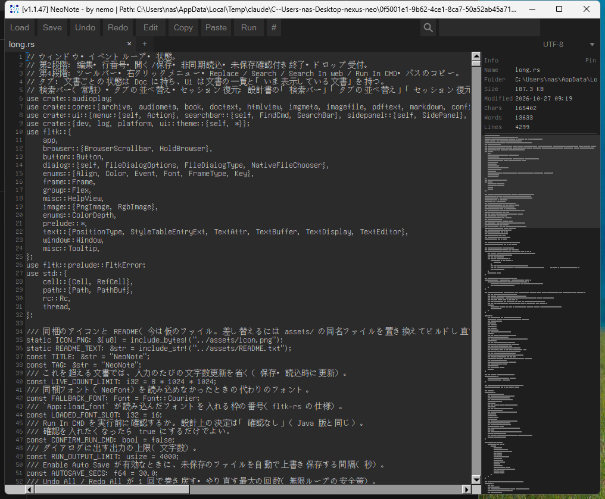 | 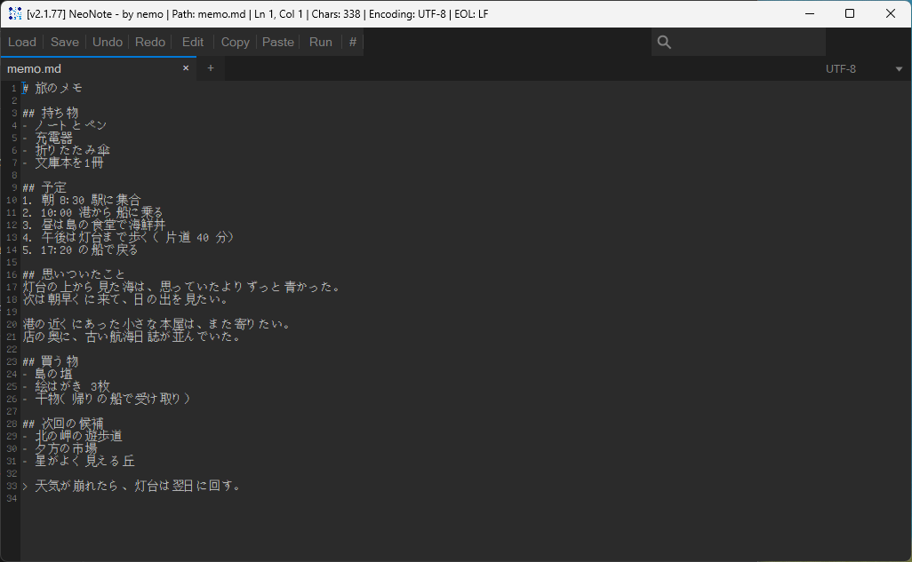 |
| 右パネル：ファイル情報とミニマップ | 行番号はマウスを左端へ寄せた時だけ表示 |
| 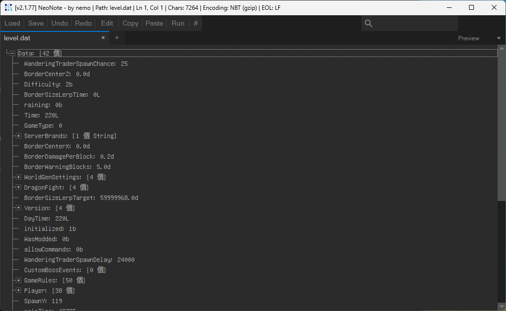 | 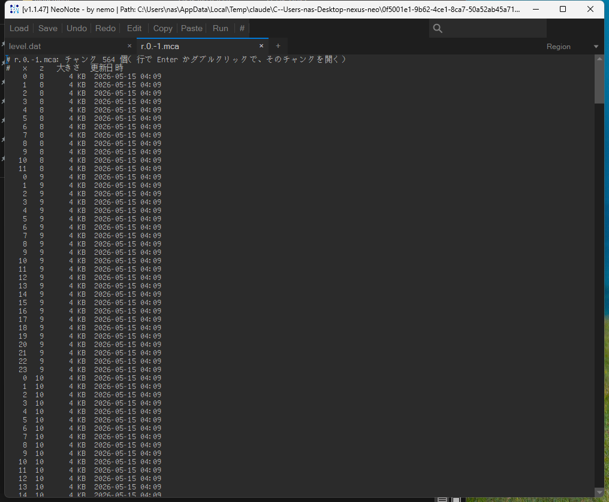 |
| level.dat をツリー形式で編集 | level.dat をテキスト（SNBT）で編集 |

---

## ❱ 配色【Themes】

既定は、暗い配色の **濡羽**（黒と緑）と、明るい配色の **月白**（白と青）。

| classic_dark | classic_light | nord |
|:---:|:---:|:---:|
| 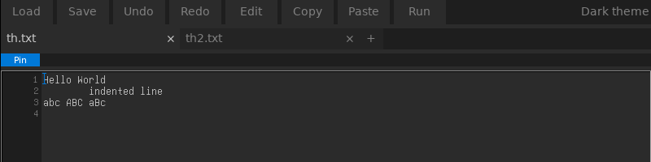 | 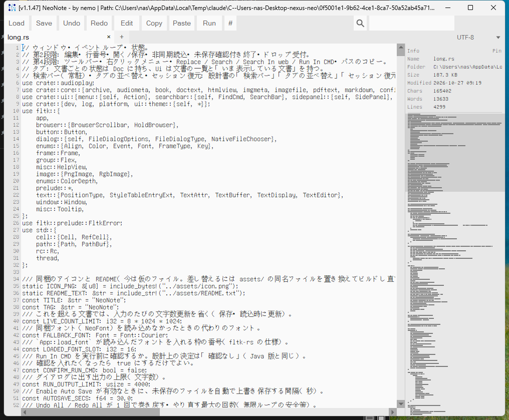 | 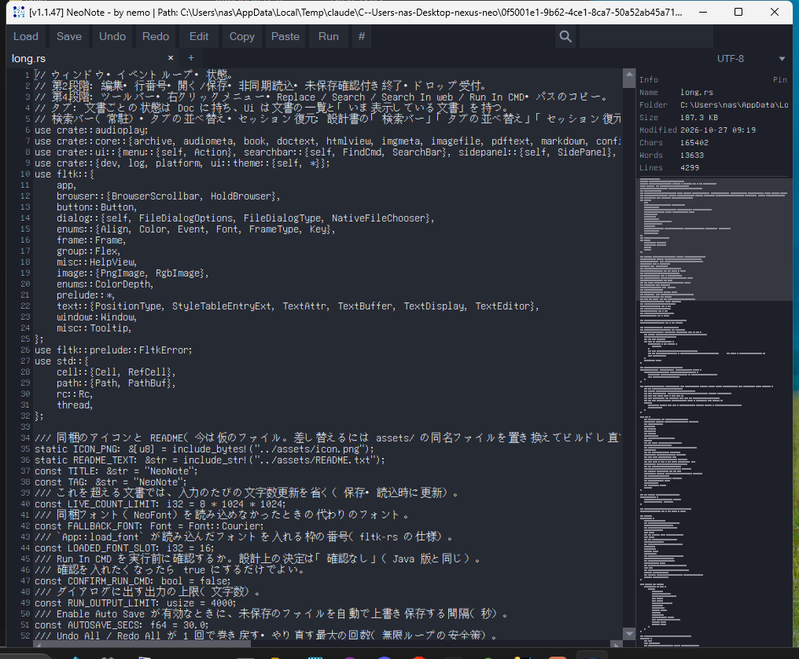 |
| **abyss** | **paper** | **sakura** |
| 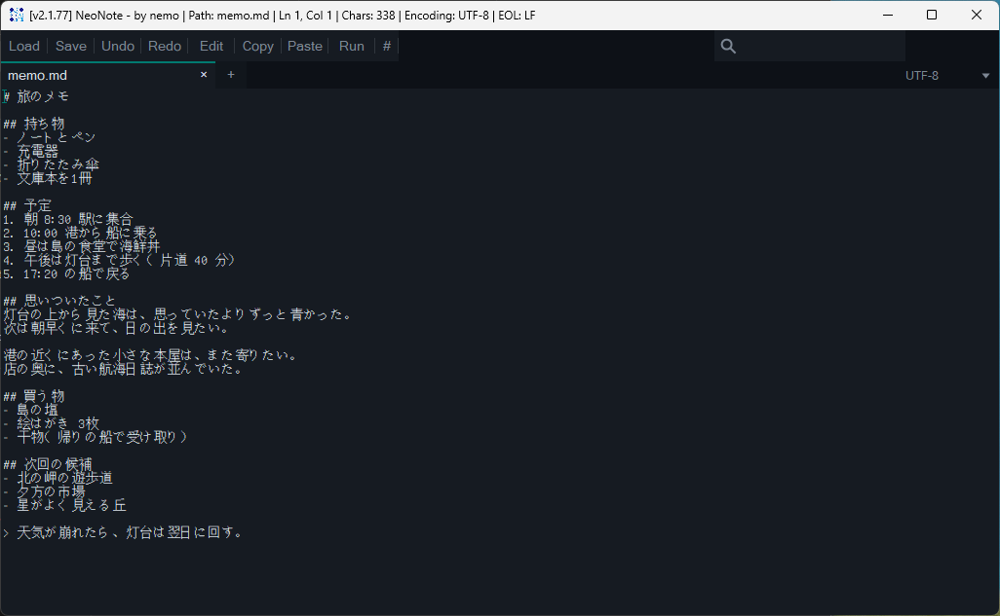 | 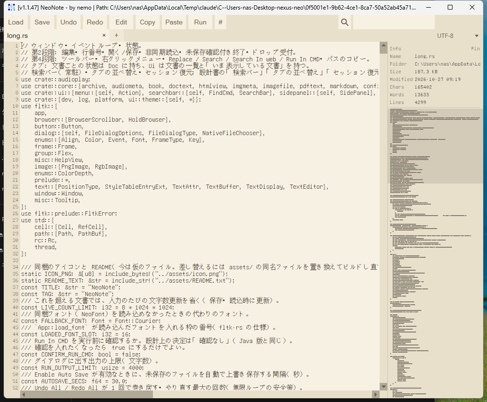 | 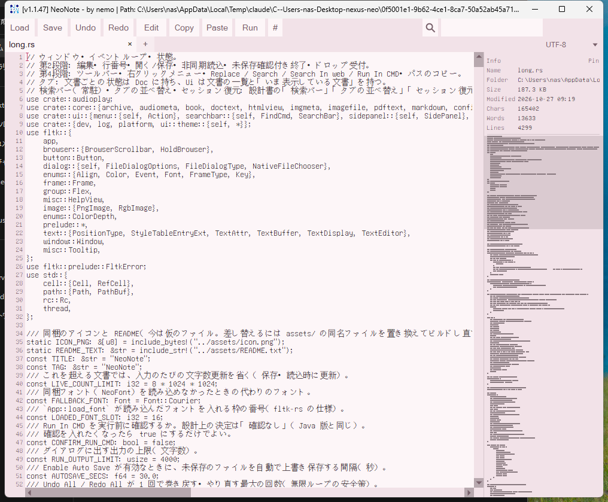 |

ほかに **Discord 風**・**GitHub 風** の配色もある（各社の公式の物ではない）。

検索欄の左の月のボタンを押すと濡羽と月白を切り替え、マウスを乗せると一覧から選べる。**custom** を選ぶと、設定ファイルに書いた5色（`#rrggbb`）で独自の配色を作れる。
どの配色も、文字と背景のコントラスト比をテストで確認済み。

---

## ❱ 機能【Features】

| 分類 | 内容 |
|---|---|
| ✏️ 編集 | タブ・元に戻す / やり直し（一括も可）・Magic Select（単語→行→段落→全体）・字下げ・自動字下げ・行単位の切り取り / コピー・前後への貼り付け |
| 🔍 検索 | 常駐する検索バー（虫眼鏡で次の一致へ）・スマートケース・置換（置換ボタンのダブルクリックで全て）・Web で検索 |
| 💾 保存 | 自動保存・外部での変更の検知・続きから（前回のタブと未保存の変更を戻す）・ファイル履歴・失う変更がある時だけ閉じる前に確認 |
| 🔤 文字コード | UTF-8 / Windows-31J / EUC-JP / UTF-16LE / UTF-16BE / ISO-8859-1 / US-ASCII・保存できない文字があれば事前に警告 |
| ↩️ 改行 | CRLF / LF / 混在の表示と変換 |
| 👀 プレビュー | Markdown（GitHub に近い見た目。コード・引用・注記・表・チェックボックス）・HTML（色と揃えも再現）・CSV / TSV・xlsx / ods・docx / pptx / epub・zip / tar / gz の一覧・画像・音声。txt なども形式を選んで表示 |
| 🌈 色分け | Python・JavaScript / TypeScript・Java・C / C++・Rust・Go・シェル・SQL・CSS・JSON など。Minecraft の `.mcfunction` は、括弧と引用符の閉じ忘れに細い下線 |
| 🎯 乗せて確かめる | カラーコード（`#rrggbb`・`rgb()`・色の名前）・文字参照と `\u` エスケープ・UNIX 時刻・画像のパス |
| 📊 右パネル | ファイル情報・ミニマップ。フォルダ・zip では中身の大きさを面積で表す図（WizTree のような表示） |
| ⛏️ NBT | `.dat`・`.nbt`・`.schem`・`.litematic`・`.mca`（チャンクの一覧から開く） |
| 🧩 HEX | 1行16バイト・不正な箇所があれば位置を示して保存を中止 |
| 🖥️ 表示 | 折り返し（既定で有効）・文字サイズ・全画面（`F11`）・最前面に固定・文字数 / 行数 / 単語数・行番号と右パネルの幅の調整 |
| 🛠️ ほか | JSON の整形・コマンドプロンプトでの実行・パスのコピー・デスクトップへのショートカット |

---

## ❱ 信条【Philosophy】

- ✍️ **「書く」ことに集中できるデザイン**
  - 行番号や情報パネルは、必要な時だけそっと現れる。普段は文字だけが並ぶ静かな画面。
  - 折り返しを標準にして、長い行でも横にスクロールせず読み進められる。
- 🪶 **軽さを守るための引き算**
  - 多機能な開発ツールにはしない。メモ帳に必要なものだけを、ツールバーと右クリックメニューに収める。
- 🛡️ **ファイルを守る安全な設計**
  - 開いたファイルの文字コードや改行の形式はそのまま。保存しても、意図しない変化を起こさない。
  - Minecraft のワールドも安心して編集できる。編集した部分だけを書き換え、それ以外には手を触れない。
  - 書き間違いがあれば保存を止めて、その場所を知らせる。
- 📐 **細部まで整えた、すっきりした見た目**
  - 余白と大きさに一定のリズムを持たせ、どの画面も同じ感覚で使える。
  - 選択中の項目は控えめなラインで示し、目に優しい配色で長時間でも疲れにくい。
- 📦 **ひとつのファイルで完結**：インストールも追加の部品も不要。どこへ置いてもすぐ使える。
- 🔤 **オリジナルフォント**：作者自作の NeoFont を同梱。

*Only for Writing. Light. Fast. Clickless. Tuned to be yours.*

---

## ❱ 操作【Controls】

| キー | 動作 | キー | 動作 |
|---|---|---|---|
| `Ctrl+O` | 開く | `Ctrl+S` | 保存 |
| `Ctrl+T` | 新しいタブ | `Ctrl+W` | タブを閉じる |
| `Ctrl+F` | 検索 | `Ctrl+H` | 置換 |
| `Ctrl+G` | 指定行へ移動 | `Ctrl+E` | 文字コード |
| `Alt` | 左右のパネルを開閉 | `F11` | 全画面 |
| `Ctrl+ホイール` | 文字サイズ | `Ctrl+Tab` | タブの切り替え |

- 画面の左上の押しピンでウィンドウを最前面に固定、その下の `#` で行番号を常に表示する。`#` の右の境目、右パネルの左の境目はドラッグで幅を変えられる。
- タブ行の右端は、左が表示の形式（Format）、右が文字コード（Encode）の切り替え。どちらも一覧の先頭の Auto で自動に戻せる。
- 検索欄の左の旗のボタンで言語、月のボタンで配色を切り替える。マウスを乗せると一覧が出る。
- タブはドラッグで並べ替えられる。入る場所に線が出る。

その他の操作は [docs/USAGE.md](docs/USAGE.md) を参照。

---

## ❱ 更新履歴【ChangeLog】

- **開発中：** 続きから・マウスを乗せて開くメニュー・乗せて確かめる値・HTML の色の再現・フォルダの大きさの図・最前面の固定・アプリの中に出す確認画面・日本語と英語の切り替え・新しい既定の配色（濡羽・月白）・Discord と GitHub の配色・コードの色分け・GitHub に近い Markdown のプレビューを加えた。
- **最新（v2.1.77）：** Minecraft の NBT をテキストとツリー形式で編集できるようにし、配色の追加と右パネルを加えた。
- **すべての履歴：** [changelog.md](changelog.md)
- **Discord：** [更新履歴チャンネル](https://discord.com/channels/1233036571243188296/1363604094895521944)

---

## ❱ 権利【License】

- NeoNote は無償で使える。許可のない再配布・改変は禁止（[LICENSE](LICENSE)）。
- 使っている第三者のソフトウェアとフォントのライセンスは [THIRD_PARTY_LICENSES.txt](assets/THIRD_PARTY_LICENSES.txt)。アプリでは「開く」の「ライセンス」で開ける。
- NeoNote is based in part on the work of the FLTK project (https://www.fltk.org).
- 同梱のフォント NeoFont は GNU Unifont をもとにした物（SIL Open Font License 1.1）。
- Discord・GitHub・Minecraft は各社の商標。NeoNote は Discord・GitHub・Mojang・Microsoft と関係がない。

---

## ❱ 連繫【Link】

- **README：** [Discord](https://discord.com/channels/1233036571243188296/1360947282106777712/1360947282106777712)
- **Download：** [Releases](../../releases)
- **Usage：** [docs/USAGE.md](docs/USAGE.md)
- **Design：** [docs/DESIGN.md](docs/DESIGN.md)
- **Contributing：** [CONTRIBUTING.md](CONTRIBUTING.md)
