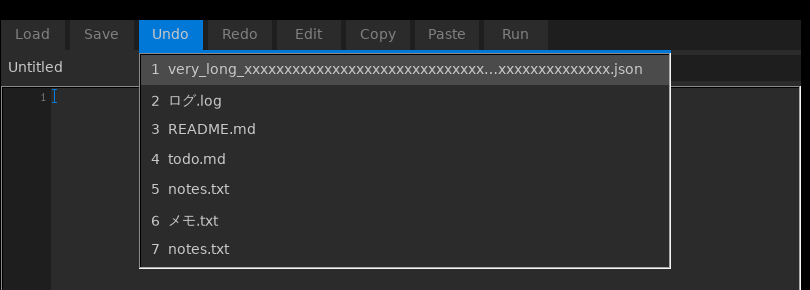
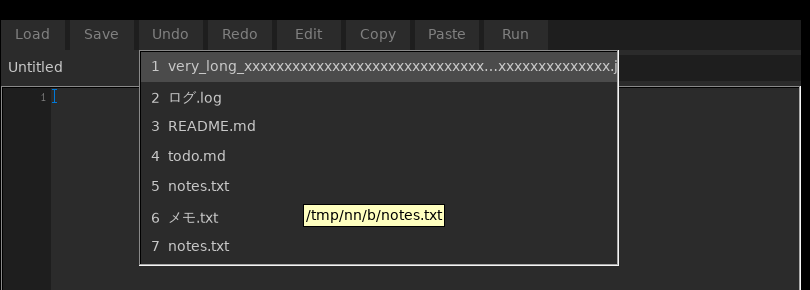
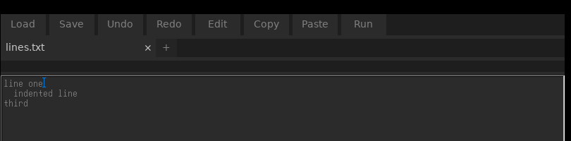
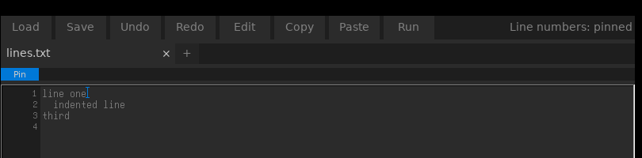

# NeoNote 詳しい使い方

軽く、早く、省クリック数で「文字を書く」ためだけのエディタ。Java/Swing 製 SwingNeoNote の Rust 移植プロジェクト。

> Only for Writing. Light. Fast. Clickless. Tuned to be yours.

## 方針（要約）

- 純粋なテキストエディタ。IDE 化しない。AI 機能・メモ帳に不要な煩雑な機能は足さない。
- 依存は最小（`fltk` と `encoding_rs` のみ）。単一バイナリ。
- 拡張の入口は「ツールバーのボタン」と「右クリックメニューの項目」だけ。
- ゲームからは `neonote [パス...]` を別プロセスとして起動する。

詳細は [docs/DESIGN.md](DESIGN.md)（設計判断・機能対応表・移植手順・未確認事項）を参照。

## 構成

フォルダの分け方（git に入れる物・配布物・ローカルの物）とビルドの手順は [contributing.md](../contributing.md) を参照。

| パス | 内容 |
| --- | --- |
| `src/`, `build.rs`, `Cargo.toml` | Rust のソース |
| `assets/` | 実行ファイルに埋め込むフォント・アイコン・README の文 |
| `vendor/miniaudio/` | 音声の簡易再生に使う C ライブラリ |
| `docs/DESIGN.md` | 設計書（確定した設計判断と未確認事項） |
| `admin/java/` | 移植元の Java ソース（SwingNeoNote / Log / FileDropHandler） |
| `admin/README_original.md` | 受け取った元の資料の README |
| `admin/integration/java/` | ゲーム側に入れる置換版 `FileDropHandler.java`（`neonote <パス>` を別プロセスで起動） |

## ビルド

```text
cargo build --release
```

Windows 11 でビルド・ユニットテスト・簡単な操作を確認済み。Linux は第6段階まで確認済み。macOS は未確認。

## 実装状況

| 段階 | 状態 |
| --- | --- |
| 1 骨組み（log / dev / 起動引数 / 空のウィンドウ） | 完了 |
| 2 テキスト編集の基本（行番号・開く/保存・非同期読込・未保存確認付き終了・ドロップ） | 完了 |
| 3 エンコーディング（UTF-8 / Windows-31J / ISO-8859-1 / US-ASCII、自動判定、BOM、変換不能文字の警告）。第26段階で EUC-JP / UTF-16LE / UTF-16BE を追加（未検証） | 完了 |
| 4 右クリックメニューとツールバー（Replace / Search / Search In web / Run In CMD / パスのコピー、未実装項目はグレー表示） | 完了 |
| 5 HEX エディタ（バイナリは自動で HEX で開く、`Ctrl+E` で切替、バイト列として保存、不正な箇所は位置を示して保存を拒否） | 完了 |
| タブ（作者の判断で追加。複数ファイルを 1 ウィンドウで編集） | 完了（ゲームからのドロップは別ウィンドウのまま。DESIGN.md の「タブ機能」参照） |
| 7 残りのメニュー項目（Open Recent / Open HomePage / Make Shortcut / Check Update / Enable Auto Save / Undo All / Redo All / Select / Magic Select / Deselect / Copy Selection / Copy Line / Paste Before / Paste After） | 完了（**未実装で残り 3 項目**: View History / Restore From History / Copy to Clipboard History。「履歴」の定義が未決。DESIGN.md「第7段階」参照） |
| 11 配色を 5 色のパレット（main / sub / accent / text / subtext）に統一し、ダーク・ライトを追加（Run の右クリック → Toggle Theme、`theme=` に保存） | 完了（DESIGN.md「第11段階」参照） |
| 10 改行コードの表示（タイトルに `EOL: CRLF/LF/Mixed`）と変換（右クリック → Convert Line Ending） | 完了（DESIGN.md「第10段階」参照） |
| 9 検索の大文字小文字（スマートケース）/ Tab・Shift+Tab のインデント / Enter のオートインデント（CRLF の改行コードも保つ） | 完了（DESIGN.md「第9段階」参照） |
| 8 メモ帳に足りない基本機能（Word Wrap / Go To Line / 文字サイズ / 行・桁の表示 / 外部変更の検知）。改行コード（CRLF/LF）は読み書きでバイト単位に保たれることを確認済み | 完了（残りは印刷のみ。DESIGN.md「第8段階」参照） |
| 12 検索バーの常駐 / タブの並べ替え（ドラッグ・`Ctrl+Shift+PageUp/Down`）/ セッション復元（引数なしの起動で前回のタブを開き直す） | 完了（DESIGN.md「第12段階」参照） |
| 6 フォント・アイコン・Java 側の置換 | 一部完了（フォント選択・Java 側の置換は完了。アイコン・README 表示は資料が無く未着手） |

操作: `Ctrl+O` 開く（複数選択可） / `Ctrl+S` 保存 / `Ctrl+Shift+S` 名前を付けて保存 / `Ctrl+E` 文字コード・改行コード / `Ctrl+T`・`Ctrl+N` 新規タブ / `Ctrl+W` タブを閉じる / `Ctrl+F` 検索バーを開く（使うときだけ開く。入力すると強調、`Enter`・`Shift+Enter` で次・前、`Esc` で閉じる） / `F3`・`Shift+F3` 次・前の検索結果 / `Ctrl+Shift+PageUp`・`PageDown` タブを左・右へ / `Ctrl+H` 置換（検索バーの置換欄。`Enter` で全置換） / `Ctrl+G` 指定行へ移動 / `Ctrl++`・`Ctrl+-`・`Ctrl+ホイール` 文字サイズ / `Ctrl+0` 文字サイズを既定に / `Ctrl+Z` 元に戻す / `Ctrl+Y`・`Ctrl+Shift+Z` やり直し / `Ctrl+A` 全選択 / `Ctrl+C`・`Ctrl+X`・`Ctrl+V`（macOS は Cmd）。`Ctrl+Tab` / `Ctrl+Shift+Tab` でタブを切り替える。`Tab`（複数行を選択中）・`Shift+Tab` で字下げ / 字下げを外す。Enter は前の行の字下げを引き継ぐ。`Ctrl+F` の検索は、小文字だけで打つと大文字小文字を区別せず、大文字を含めると区別する。フォルダ・zip のタブ（一覧）では、検索は中の名前とファイルの本文（フォルダ・zip の文字のファイルだけ）を探し、一致する項目とその親のフォルダだけに一覧を絞る（`/` を含めると道筋全体で探す。置換はできない）。

タブはツールバーの下に並ぶ。ファイルを開くと新しいタブになり、同じファイルはそのタブへ移る。起動引数に複数のパスを渡すとそれぞれタブで開く。`×` か中クリックで閉じる。閉じると失う変更があるときだけ、保存 / 破棄 / キャンセルを聞く（名前の無いタブが空白だけのとき、ファイルのタブを元に戻したときは聞かない）。確認はアプリのウィンドウの中に出し、`Enter` で保存、`Esc` でキャンセル。最後のタブを閉じると終了する。タブはドラッグで並べ替えられる。

**続きから**: 引数なしで起動すると、前回終了時に開いていたタブを同じ並びで開き直し、未保存だった変更も未保存の印付きで戻す。タブの並びは `config.txt` の `session=`、未保存の本文は設定フォルダの `unsaved/` に、終了時と 2 分ごと（中身が変わったときだけ）に書く。有効な間は、終了しても保存を確認しない。Load の `Resume`（または `config.txt` の `resume=false`）で切ると、控えを消し、終了時に保存を確認するふつうのメモ帳の動きになる。

**設定の場所**: OS の設定の場所の `neonote` フォルダ（Windows は `%APPDATA%\neonote`、macOS は `~/Library/Application Support/neonote`、Linux は `$XDG_CONFIG_HOME/neonote` か `~/.config/neonote`）。実行ファイルの横に `neonote` フォルダがあれば、そちらを使う（持ち歩き用）。

既定のフォントは同梱の NeoFont（`assets/NeoFont.ttf`、バイナリに埋め込み済み。作者: nemo の自作フォント）。他のフォントは Load または Run のメニューの `Font` で `.ttf` / `.otf` を選んで読み込む（`config.txt` の `font=` に残り、次の起動でも使う）。Run の `Reset Font` で NeoFont に戻せる。

ツールバーのボタンは押すと主な動作。マウスを乗せる（または右クリック）と、ボタンの真下にそのボタンのサブメニューが開く。サブメニューには、ボタンを押したときと同じ動作は出さない。項目の表記はなるべく 1 語で、マウスを乗せると説明がツールチップで出る。右の余白をクリックすると現在のパスをコピーする。

左端の列は、上からツールバーの押しピン（ウィンドウを最前面に固定。Windows のみ）、タブ行の `#`（行番号を常に表示）、本文の行番号で、3 つとも同じ幅。`#` の右の境目をドラッグすると行番号欄を広げられる（`config.txt` の `gutter_extra`）。右パネルは左の境目をドラッグして幅を変えられる（`side_w`）。右端の列も同じで、上から、検索バー、Format と Encode、右パネルの 3 つが同じ幅になり、右パネルの幅を変えると一緒に変わる（Format の左の境目のドラッグでも変えられる）。

編集領域の右クリックメニューは Cut / Copy / Paste / Replace / Search / Search In web / Select All / Change View / Change Encoding / Run In CMD など。Search は選択した文字列と同じ箇所をアクセント色で強調し、何も選ばずに実行すると消える。

タブ行の右端は 2 つのチップ。左は表示（Text / Preview / HEX）で、文字の文書は `Preview as Markdown` / `Preview as HTML` / `Preview as CSV / TSV` で、拡張子に関係なく形式を選んでプレビューできる（タブを閉じるまで覚える）。右は文字コード・改行コード。

**乗せて確かめる**: 本文の次の値にマウスを約 0.3 秒乗せると、小さな窓で中身を見せる。カラーコード（`#rgb`・`#rrggbb`・`#rrggbbaa`・`rgb()` / `rgba()`、css・html・svg・xml・json では `red` などの色の名前も）は色の見本、文字参照（`&hearts;`・`&#x3042;`）と `あ` などのエスケープはその文字と U+XXXX、UNIX 時刻（10 桁の秒・13 桁のミリ秒、2001〜2100 年）は日時、画像ファイルのパス（開いているファイルの場所から見て実在する物）は縮小画像。

**右パネル**: ファイルの情報と本文の縮小表示。フォルダ・zip・tar では、縮小表示の代わりに中身の大きさを面積で表す図（ツリーマップ）を出す。フォルダは入れ子の枠、ファイルは拡張子ごとの色で、マウスを乗せると大きさとパスが下に出る。

文字コードは開くときに自動判定する（既定。UTF-8 / UTF-16 は BOM も見る。BOM なしの UTF-16 は ASCII の多い文書だけ推定し、EUC-JP は Windows-31J として読めないときの次点。外れたら手動で選ぶ）。`Ctrl+E`（文字コードのチップ）のメニューは上から UTF-8 / Windows-31J / EUC-JP / UTF-16LE / UTF-16BE / ISO-8859-1 / US-ASCII / Auto / 改行コードで（HEX は表示のチップ）、固定するとディスクから読み直し、Auto で自動判定に戻る。保存時に表せない文字があれば、保存前に「キャンセル / UTF-8 に変えて保存 / ? に置き換えて保存」を選ぶ。

HEX 表示は 1 行 16 バイトで、`オフセット  HEX×16  |ASCII|`。編集できるのは HEX 部分だけで、オフセットと ASCII 欄は保存時に読み飛ばし、保存後に作り直す。2 桁の 16 進数（空白区切り）以外が混ざると、その行・列にカーソルを移して保存を中止する（ファイルは書き換えない）。16 MiB を超えるファイルは先頭だけ読み、保存は無効。

## 第7段階の使い方（要点）

項目の名前は今の表記（1 語）で書く。かっこの中は以前の名前。

- **Edit** ボタンを押す = Magic Select。押すたびに、選択が 単語 → 行 → 段落 → 全体 と広がる。サブメニューは Word（Select）/ All（Select All）/ Deselect / Copy（Copy Selection）。
- **Copy** のサブメニュー: Line（Copy Line）/ Cut（Cut Line）/ Name（Copy File Name）/ Stash（Copy to Clipboard History。選択か行を履歴に貯める。最大 10 件）。**Paste** のサブメニュー: Before / After（選択を置き換えず、前 / 後ろへ貼る）/ History（Paste From History）。
- **Shift+クリック**（Ctrl / Cmd+クリックも可）: 本文の `neofunction:asset/bossbar/hide` のような `ns:path` をクリックすると、指すファイル（関数・advancement・enchantment・`#` のタグなど）を、開いているファイルの近くのデータパックから探して新しいタブで開く。マウスを乗せると案内が出る。
- **Header**（MC Header。Run のサブメニュー、編集領域の右クリック）: 保存してある `.mcfunction` の先頭に、その関数を呼んでいる関数・進捗・エンチャント・関数タグと自分の ID のヘッダー（`# >/function …` と `# =/function …`）を作る。探すのはそのファイルが入っているデータパックの中だけ。命名・説明・独自の項目は残る。
- **JSON**（Format JSON。Run のサブメニュー、編集領域の右クリック）: 選択範囲、無ければ全文を JSON として整形する。不正な JSON は書き換えず、位置を示す。
- **Undo** / **Redo** のサブメニュー: All（Undo All / Redo All）で戻せなくなるまで繰り返す。History（View History。過去に読み込んだファイルの履歴をファイル名で一覧し、ダブルクリックか Enter でタブに開く）/ Restore（Restore From History。いま開いていない最新の 1 件をすぐ開く）。存在しないファイルは自動で履歴から消える。履歴は全文書で共通・新しい順・最大 100 件で、`config.txt` の `history=` に保存され終了後も残る。
- **Save** のサブメニュー: Save As / Autosave（Enable Auto Save。チェック式。30 秒ごとに未保存のファイルを上書き。状態は設定ファイルに残る）。
- **Load** のサブメニュー: New / Folder / Close / Recent（最近開いたファイル。終了後も残る）/ Readme / Homepage / Font / Config（設定ファイルをタブで開く）/ Resume（続きから）/ Shortcut（デスクトップにショートカット）/ Update（配布ページを開く）/ Exit。
- **行番号欄**: 普通は隠れていて、マウスが左端にあるときだけ出る。タブ行の左端の `#` で常に表示に固定できる（次回起動も引き継ぐ）。

## csv / tsv の表示（簡易対応）

`.csv` / `.tsv` は文字として開く（編集はふつうのテキスト）。タブ右端のチップ → **Preview** で、罫線つきの表で見られる（1 行目は見出し）。`.csv` は `,` のほか `;`・タブ・`|` 区切りも先頭の数行から自動で判定する。数だけが並ぶ列は右寄せになる（右寄せは未検証）。引用符・`""`・セル内の改行・CRLF・BOM を読む。表示は先頭 500 行・30 列までで、超えた分は注記が出る（全体は Text で見られる）。読み取り専用で、表の中では編集しない。

## xlsx / ods の表示（簡易対応・未検証）

`.xlsx` / `.xlsm` / `.ods` はバイナリなので最初は HEX で読み込まれ、自動で Preview に切り替わる（チップから HEX にも戻せる）。シートごとに名前の見出しと罫線つきの表で出し、1 行目を見出し、数だけの列は右寄せにする。日付の書式のセルは `YYYY-MM-DD` で出る。表示は各シート先頭の 500 行・30 列まで、シートは 50 枚まで。読み取り専用で、数式は計算済みの値だけ。書式・結合セル・画像・グラフ・旧形式 `.xls` は未対応。zip の展開は自前（依存の追加なし）。**ビルド・動作とも未検証。**

## docx / odt / pptx / odp / epub の表示（文字だけ・簡易対応・未検証）

`.docx` / `.docm` / `.odt` / `.pptx` / `.pptm` / `.odp` / `.epub` もバイナリなので最初は HEX で読み込まれ、自動で Preview に切り替わる（チップから HEX にも戻せる）。本文の**文字だけ**を出す: 見出し・段落・リスト（「・」の記号だけ。番号は出さない）・罫線つきの表。docx / odt は 1 続き、pptx / odp はスライドごと、epub は章（読む順）ごとに `── 1 / N ──` で区切る。ふりがな・脚注・コメント・変更履歴の削除分・ヘッダー / フッター・スライドのノートは出さない。チップのメニューの **Text in New Tab** で、文字を新しいタブに写して編集できる（元のファイルは変えない）。文字数は約 400 万字、スライド・章は 1000 までで、超えた分は注記が出る。読み取り専用で、書式・画像・図形・グラフ・旧形式（`.doc` / `.ppt`）・パスワード付きは未対応。zip の展開は自前（依存の追加なし）。**ビルド・動作とも未検証。**

## html / htm の表示（簡易対応・未検証）

`.html` / `.htm` / `.xhtml` は文字として開く（編集はふつうのテキスト）。表示のチップ → **Preview** で見られる。JavaScript は効かず、`HelpView` が描ける形にタグを絞って出す: 見出し・段落・リスト・表（罫線つき）・太字 / 斜体 / 下線・コード・`pre`・引用。`div` などの入れ物は改行になるだけ。

色と揃えは、`<style>`（`head` の中も）・`style` 属性・古い属性（`bgcolor`・`text`・`color`・`align`）から読んで出す: ページの背景色・文字色・リンクの色、文字の色、表・行・セルの背景色、段落・見出し・セル・`div` の左右揃え。`<style>` はタグ名・`.class`・`#id`・`tag.class` の単純な指定だけを読む。読めない値（`var()`・`hsl()`・`transparent` など）は捨ててテーマの色のまま描き、背景に溶けて読めない文字色は黒か白にする。余白・枠線・フォント・横並びのレイアウトは出さない。

`head` の中の文字（`title` を含む）・`script`・フォーム・動画・iframe・svg は出さず、`display:none` で隠された要素も出る。リンクは辿れず、文字のあとに「 (URL)」を添える。画像は html のあるフォルダのローカルの画像（png / jpg / gif / bmp）だけ出し、URL の画像は `[alt]` の文字になる。閉じタグの省略は補う。文字コードは開くときに決めたもの（`<meta charset>` は見ない）。読む上限は約 4 MB で、超えると注記が出る（全体は Text で見られる）。読み取り専用で、Preview の中では編集しない。**ビルド・動作とも未検証。**

## tar / tar.gz / gz の一覧（簡易対応・未検証）

`.tar` / `.tar.gz` / `.tgz` / `.gz` は、フォルダ・zip と同じ階層ツリーで中身の一覧を見られる（開くと Preview で始まる）。名前・フォルダ・大きさだけを出し、**取り出し・書き換え・名前変更はしない**（`Rename (text)` は zip とフォルダだけ）。tar は ustar / GNU / PAX の長い名前と大きなファイルを読む。リンク・デバイスは出さない。`.gz` は展開して、中身が tar なら tar として、そうでなければ元の名前の 1 ファイルとして出す（gzip の 1 つ目のメンバーだけ）。ファイルは 256 MiB まで、gzip の展開後も 256 MiB まで、項目は 50,000 件まで。形式が違う・壊れている・大きすぎるときは、ふつうのファイルとして（HEX で）開く。`.bz2` / `.xz` / `.zst` は未対応。**ビルド・動作とも未検証。**

## 画面（使い方の説明用）

画像は `docs/screenshots/` にある（説明は同じフォルダの `README.txt`）。

**View History**（Undo の右クリック → View History）: 開いた元のボタンが青くなり、行をダブルクリック（または Enter）でそのファイルを開く。行にマウスを乗せるとフルパスが出る。




**行番号欄**: 普通は隠れ（左）、マウスが左端に来ると出て（中）、`#` で固定できる（右）。





**配色**: ダークとライト（上から順）。Run の右クリック → Toggle Theme。


